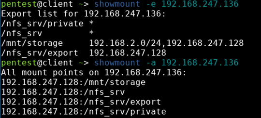
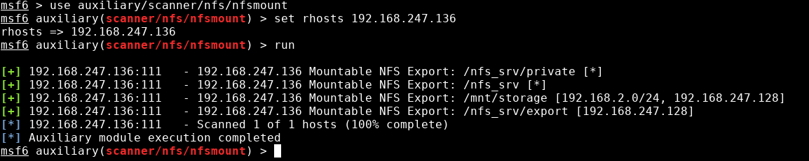
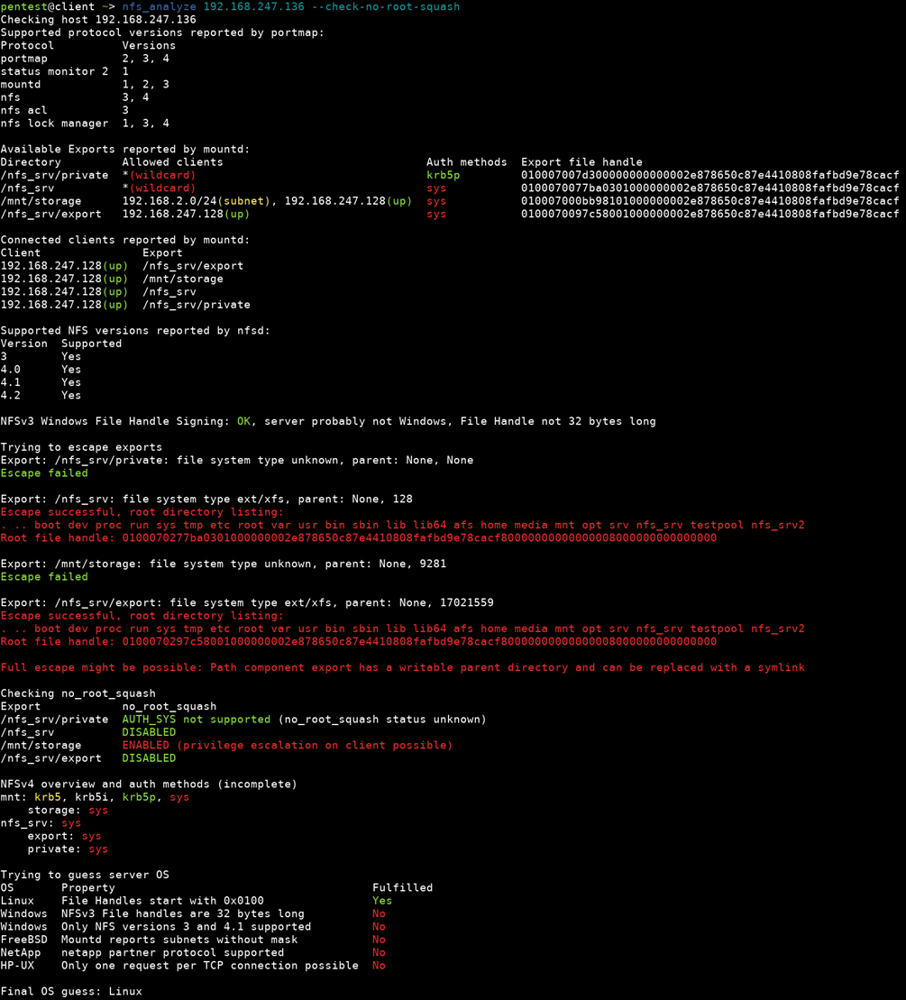
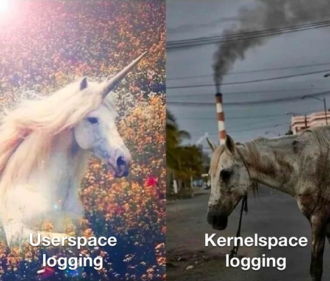

> **Mirror:** This post was originally published on the HvS-Consulting blog on 29.12.2024 and is mirrored here unchanged for preservation. I co-authored it with [Philipp Tekeser-Glasz](https://github.com/philipp-tg). Original: <https://www.hvs-consulting.de/en/blog/nfs-security-identifying-and-exploiting-misconfigurations>

The following post will describe some technical attacks that can sometimes be performed against NFS shares. We will talk about security features of the NFS protocol, common configuration mistakes and how to abuse them. We developed some tooling that allows us for a better understanding of the configuration of NFS endpoints discovered on the network as well as to identify and abuse certain misconfigurations. Though we didn’t perform a security audit on the NFS code and all issues identified are related to how NFS is intended to work, we informed respective projects if noteworthy misconfigurations in their default setups have been discovered.

## A closer look at NFS security

NFS, the Network File System, is a widely used protocol for accessing files on a remote system. Similar to Microsoft’s SMB (Server Message Block) protocol, it allows its users to interact with data stored on a remote server. The protocol was developed by Sun in the 80s, multiple versions are specified in various RFCs and due to its free license, it is widely adopted.

All major operating systems as well as storage appliances, from home to enterprise sizing, support NFS. Unsurprisingly, we encounter NFS commonly on our security assessments and it regularly gives us access to critical data - we’ve seen quite a lot, from unauthenticated access to latest R&D data to backups of all virtual machines in otherwise well hardened environments.

Despite the wide adoption in networks of any size and amongst virtually all major platforms, we felt that there is little tooling for working with NFS from an offensive perspective, so we decided to have a closer look at the protocol and see if there are any gaps we can fill.  
We confirmed many of our initial assumptions and found plenty of other interesting things we’d like to share with our readers in this blog post.

On assessments, when dealing with NFS we prevalently see a mix of Linux and Windows systems, as homogenous Windows environments usually use SMB while in our experience, BSD or other systems are rather exotic encounters. As Linux is the denominator here (and, surprisingly, we didn’t find much noteworthy to tell about the Windows implementation), we’ll focus on the Linux implementation (and also refer to its terminology) here.

## Basic overview: How NFS works

Because of the long history behind NFS, the protocol has some very interesting security properties. The NFS protocols specifies that servers provide file access to clients over the network. An export is a directory on the server that can be accessed by clients (think of it as a *share*).

As NFS is just a protocol specification, the feature set and configuration options may differ depending on the platform involved. Both the server and the client are usually integrated into the operating system kernel. There are also some implementations of the NFS protocol that run only in userspace which is useful for development and testing.

On Unix server implementations, there is usually a configuration file called `/etc/exports` that contains every directory that is supposed to be exported as well as some options for these exports. The exact configuration format may differ between operating systems.

On Linux, `/etc/exports` has the following format:

```
/PATH/TO/EXPORT_1      CLIENT1(OPTIONS1) CLIENT2(OPTIONS2) ...
/PATH/TO/EXPORT_2      CLIENT3(OPTIONS3) CLIENT4(OPTIONS4) ...
[...]
```

Each line contains the path to the exported directory, clients that are allowed to access the export and options for that client separated by commas without spaces in between. It is also possible to have multiple lines for the same export. For example, a configuration entry that allows authenticated (Kerberos) access to the `/media/disk/share` export over the network from `192.168.2.123` could look like this:

```
/media/disk/share   192.168.2.123(rw,sec=krb5p:krb5i)
```

Once the exports are configured, clients can mount them and use them like local file systems. In the background, file operations are sent to the server over the network. Mounting an NFS export works like mounting any other device or network share, we will talk about this with a bit more details later. NFS is commonly used in version 3 and 4. There is a significant difference from an architectural point of view, but most setups we see provide NFSv3 and NFSv4 compatibility, therefore we do not overcomplicate this blog post by differentiating between the protocols unless necessary.

## Deep Dive into NFS Security: Understanding its mechanisms

### Authentication

The NFS protocol offers multiple authentication methods which are also called authentication flavors. The most common ones are `AUTH_SYS` and `RPCSEC_GSS` (which, simplified, is usually Kerberos) that are supported by most servers and clients. Multiple authentication methods can be allowed for an export by using the option `sec=FLAVOR1:FLAVOR2:...` The available options are `sys, krb5, krb5i and krb5p`.

`AUTH_SYS` is the easiest authentication method and usually the default setting because it does not require any further configuration on the server or client side. The client attaches a UID (user ID), GID (group id) and up to 16 auxiliary GIDs to each request and the server **simply trusts these values without any verification.**

By default, on most server implementations, only ID 0 for the root user is not allowed for security reasons (more on that later). This authentication flavor does not involve any cryptography. Another problem of this authentication flavor is that servers and clients need to make sure that a UID refers to the same user on both systems. On Linux `AUTH_SYS` is the default option, it can also be set explicitly using the `sec=sys` option.

Many NFS implementations also support Kerberos 5 authentication. There are three levels of protection that can be chosen based on the security and performance requirements of an application:

- krb5 (authentication only),
- krb5i (authentication and data integrity protection) as well as
- krb5p (authentication, integrity protection, and encryption).

The main advantage compared to `AUTH_SYS` is that server and client can cryptographically verify each other’s identity. On Windows, NFS is tightly integrated with AD and hence setting up central Kerberos authentication is not a big issue. Therefore, on rare occasions when we see NFS with Kerberos in the wild, it’s usually on a Windows server. On Linux, configuring NFS with Kerberos turns out to be a very unpleasant experience (personal experience), and unsurprisingly we usually do not see this in practice on Linux NFS servers.

A new standard that is currently established ([RFC 9289](https://datatracker.ietf.org/doc/html/rfc9289 "RFC 9289")) aims to provide cryptographic protections for RPC traffic on top of TLS. A stable implementation is expected soon. The new protocol makes accessing an NFS server similar to accessing a website using HTTPS where the server is authenticated by its certificate, but the client is not. Alternatively, it is also possible to use mTLS where the client also needs a certificate to prove its identity to the server and both sides are mutually authenticated.

Further, some NFS implementations support additional niche authentication protocols, due to their lack of adaptation and practical relevance, we won’t go into further detail on them.

### Secure ports

Back in the days, when computers filled rooms and a grumpy man was guarding access to the system like Smaug protecting his dwarf gold, fencing off evildoers was more pragmatic, and this setting is a relic of these long-gone days. It’s still there, hence many NFS servers only allow connections from ports between 1 and 1024 which means that root privileges or `cap_net_bind_service` is required to connect unless disabled by the insecure option on an export.

Normal users on a multi-user system back then did not have these privileges and could therefore not send their own requests to the NFS server in order to bypass the system’s security checks.

On modern Linux systems, the NFS server will accept requests from any port if a client uses Kerberos authentication. The Windows NFS server does not implement this option and always accepts connections from any port. We decided to mention this *cough* security mechanism for nostalgic reasons but won’t go deeper into it as a bypass should be trivial in these days.

### Squashing

As mentioned earlier, users on server and client do not necessarily share the same user id, as Alice, Bob, and Mallory each start with uid 1000 on their freshly installed systems. To overcome this issue, many NFS server implementations provide a way to map UIDs from incoming requests to other UIDs on the system.  
The Linux NFS server implements a feature called `squashing` (a similar feature on BSD implementations is called `mapping`, which replaces the UID and GID of all incoming NFS requests with another fixed one, by default `nobody` (65534 unsigned / -2 signed). On Linux there are three different squashing options that determine which IDs get squashed:

- `all_squash`, which simply squashes all accesses if file owners aren’t relevant,
- `root_squash/no_all_squash`, which is default on Linux and only squashes access with uid 0 (root) while retaining the submitted uid in all other cases, and
- `no_root_squash`, which also allows clients to access the file system as root, because, why not.

To be fair, the problem is difficult, and setting up Kerberos on Linux as the only alternative apparently leaves `all_squash/root_squash` as a viable tradeoff. We’ll come back to this later.

### Subtree check

Only available on Linux. man(5) exports says:

> "If a subdirectory of a filesystem is exported, but the whole filesystem isn’t then whenever an NFS request arrives, the server must check not only that the accessed file is in the appropriate filesystem (which is easy) but also that it is in the exported tree (which is harder). This check is called the subtree check."

**In short:** Figuring out if a file belongs to an exported folder is seemingly difficult. As we know that at some points simple things become hard (and we’re talking about a kernel here), we won’t judge and leave this statement as it is for now.

### Allowed hosts

It is possible to restrict access to an NFS export to certain hosts that can be identified by an IP address, a subnet or a hostname. Usually, server implementations can be configured to give different hosts different permissions and authentication methods.  
On Linux all of the options mentioned above can be configured individually for each host. For example, you could give some hosts only read access and some hosts read-write access to the export. When specifying hostnames, they’re resolved on server startup to ensure that they exist. When a client tries to connect to the server, a reverse lookup is performed to check if the source IP address is associated with one of the specified hostnames.

In our experience, this is commonly used and serves as the only effective security mechanism when it comes to keeping malicious forces in a network away from the data stored on exports. Sometimes, even when this mechanism is used, the allowed network ranges are too wide or allowed IPs as well as domain names aren’t used anymore, so sometimes it is enough to assign yourself the correct IP address to access the data.

## Assessing the Arsenal: Current Tools in NFS Exploitation

Now that we have a coarse understanding of how to work with and what to expect from NFS, let’s talk about accessing files and tools currently at hand.

First of all, operating systems usually bring their own tooling for regular interaction like reading and writing data on an NFS export. On Linux, `showmount` can be used to retrieve information from an NFSv3 server, which includes the list of exports, who is allowed to access these exports, as well as which clients are currently connected (which may be inaccurate if a client disconnects without telling the server).



*Output of the showmount command for enumerating NFS exports*

This is one of the few things where NFSv3 and NFSv4 differ: NFSv3 has a higher modularity and splits different tasks amongst different services. In this case, the mount service is in charge of telling the client which shares are available to whom. NFSv4 has a different architecture that does not depend on different services, instead clients just directly access the / export and try to access the desired exports from there, failing if this is not possible for any reason. If showmount (or other tools like Metasploit) do not show any export information on a confirmed NFS port, there’s a high chance that the server speaks NFSv4 exclusively.

If an export is available, it can be mounted using a command like:

```
mount -o nolock,ro <ip>:<export_path> <local mount, e.g. /mnt/nfs-mount>
```

As you can see, this looks similar to anyone that ever mounted a file system on Linux. During assessments, we usually provide additional options like ro to perform a read-only mount as we do not want to modify data and this is an additional safeguard.

When dealing with NFS on assessments, the available tooling that’s widely used boils down to the usual suspects: `nmap`, `metasploit`, as well as some unfinished and/or broken python scripts from Github (or, given the age of this research topic, Sourceforge). While the nmap NSE script didn’t work with the shares we used for testing, metasploit is usually quite reliable despite not providing additional features compared to `showmount`:



*Output of Metasploit’s auxiliary/scanner/nfs/nfsmount module*

We’d like to honorably mention [nfsshell](https://github.com/NetDirect/nfsshell "nfsshell") and [NfSpy](https://github.com/bonsaiviking/NfSpy "NfSpy"). Apparently, we’re not the first having a closer look at NFS, and these tools implemented many interesting attacks several years ago. Unfortunately, they have not been maintained for a long time.

To us, the existing tooling lacks quite some functionality and accessibility. For example, we wanted to understand which NFS versions a server supports. This becomes relevant as NFSv4 does not explicitly list its exports, therefore we should be at least aware that there *may* be data available, but we have to put in more effort to identify it.

## Don’t let your dreams be dreams: Just access the data!

Before we could develop our own tools, we had to figure out what needed to be done to gain extensive access to files on a remote file share. Our initial guess, nothing, turned out to be true: in many cases there’s technically nothing holding you back, except the lack of tooling.


*Hacker’s spirit animal*

While NFS is aware of user and group IDs and also brings mechanisms for mapping these IDs to the respective users on different systems, apparently few people are really *enforcing* these controls. As described above, Kerberos is rarely used and most shares use `AUTH_SYS`.

It is therefore possible to access basically any file on a remote NFS share (unless it’s owned by root and `no_root_squash` is not deliberately enabled) as we can check which users and groups have access to a file/folder and simply pretend to be that user or part of such a group.

Which is in practice easier said than done, especially at scale with many different users and groups. When figuring out how to approach this, we quickly found that most userspace NFS libraries are very low level which would make our goal of developing a tool for unlimited file access challenging because we need to support quite a lot of different file operations. Ideally the library should be asynchronous and written in a high-level language because writing asynchronous C code is not much fun after around 10 layers of callback hell. Luckily, during this research [@skelsec](https://twitter.com/SkelSec "@skelsec") came up with his anfs Python library and it perfectly filled that gap.

One of our tools is called `fuse_nfs`, and as people say naming things is difficult, we certainly nailed it: It’s a fuse driver for NFS. `fuse_nfs` stands out compared to other implementations because it automatically sets the required user and group ID required for accessing each file. This means that unless the server is actually authenticating users via Kerberos, this gives us full access to any non-exclusively-root-owned files on an NFS export. As this is implemented as fuse driver, this happens completely transparent so you can access the files via standard file system APIs and use your favourite tools at reasonable performance.


Yes, we hear you back there, “what about this sasquatch er squashing thing you talked before”? Good question: If everybody’s UID is mapped to nobody (`all_squash`), there’s no effective authorization and there’s been anarchy before. For default configurations (`root_squash`), we can just fake the desired user or group ID (except for files, that are only owned by root). For cases with `no_root_squash`, this is even worse as we can even fake uid 0 (root). As there’s no proper user authentication, the best thing squashing can do is protect stuff that’s fully owned by root.

## Thinking Outside the Box? Reading Outside the Export!

Remember when we were talking about `subtree_check` and only vaguely citing the man page? If `subtree_check` is not enabled and the export is not the root of a file system, it turns out that it is possible to read and write other files outside the export on the same file system. There are some preconditions for this to work, but in practice they are met quite often: The server needs to run Linux (what we see most of the time), `subtree_check` needs to be disabled (default on Linux), the root directory of the file system must have a predictable inode number (this is the case for many common file systems) and the export must not be the root of the file system (depends on your target). The last requirement is that the export must be accessible to the attacker, which means it must be possible to successfully mount it.

We tested and implemented the attack against ext4, xfs, btrfs in our tools. For btrfs, if `subtree_check` is disabled, it is possible to access data on all subvolumes and snapshots even if they are not mounted. While the attack technically also works on ZFS, only data on the same dataset as the exported directory can be accessed. When dealing with ZFS, even more nuances in server configuration are relevant. We did an internal PoC that shows that it is technically possible under the right circumstances, but due to the need for brute forcing handles and secure default configurations of appliances we looked at, we did not implement this attack as we considered the relevance in practice below the bar.  
The attack works the same way on NFSv3 and NFSv4, but our tools only support NFSv3 because there are some challenges when trying to automate it on NFSv4. Therefore, this is left as an exercise to the reader.

Back to topic: To showcase the impact of this misconfiguration, let’s assume a fully patched Debian, freshly installed with all the defaults unchanged, using ext4 as the operating sytem partition. Now, we enable NFS and export `/srv/` so users can store data there. If for example `/var/` is on the same file system (which it is unless you explicitly decided to create a separate file system for the NFS export), then it is possible to browse logs in `/var/log/`, upload a web shell in `/var/www/`, you get the idea.

Remember we mentioned earlier that files owned by root (`uid 0`) are safe by default against this attack? Well, yes, but only if the `gid` is also 0! Well, let’s see what… oh, is that `/etc/shadow` belonging to the user root but the group shadow? Unfortunately, this group has `gid 42` on Debian, and as that’s not 0, it is not affected by `root_squash`!

```
-rw-r----- 1 root shadow 1421 Feb 19 17:48 /etc/shadow
```

(Un)fortunately, the file is not writable for that group, so we can’t assign new passwords to users, but we could at least try to crack existing ones.


*Reactions differed amongst our incident response crew and the red team when learning about this*

This attack also works on SuSE Linux. RHEL/Fedora are not affected as `/etc/shadow` is owned by uid and gid 0. When accessing the file using `fuse_nfs` it will automatically assign the correct gid to the requests and the file can be read. Our other tool `nfs_analyze` automatically tries to print the contents of `/etc/shadow` if it successfully escapes an export.

We also found that it might be possible in some circumstances that if `no_root_squash` is set and you’re somehow able to trigger a restart of the NFS server, you may gain access to other file systems on the NFS server, too. As this is quite a disruptive attack and requires the ability to trigger a server restart, we won’t go into detail on [this](https://lore.kernel.org/linux-nfs/20210111192507.GB2600@fieldses.org/).

## SUID Binaries: The Key to Privilege Escalation

Apart from accessing files we’re not supposed to access, NFS is also interesting when it comes to privilege escalation opportunities. These mostly rely on insecure configurations and primarily target NFS clients, but as we live in a modern world, a server may also be perceived as a client, and you may therefore even be able to abuse this functionality under certain circumstances.

Consider the following scenario: A client mounts an NFS export without the `nosuid` flag, meaning that binaries stored on the share containing the suid flag and belonging to uid 0 are executed with root privileges. If we manage to place our own binary with the flag set on the NFS export, we can call the binary and get a root shell. The easiest way to achieve this is when the server has `no_root_squash` enabled, the attack is straight forward. In case the stars do not align as in our made-up example, there are some other scenarios where privesc is still possible. They boil down to the same idea but require some trickery, hence we won’t describe them now in detail; You’ll find references at the end of the post that will explain each of the scenarios in greater detail and we made sure our tooling provides the necessary capabilities to pull each of these attacks off. We are also sure that there are more attacks we aren’t aware of and that may not be publicly documented yet, so if you’re into file system permission trickery, you may give it a shot.

## Analyzing NFS servers and detecting misconfigurations

We developed a second tool called `nfs_analyze` that gives more detail on each server. It reads the exports, gives information on the authentication methods supported by the server, but also shows us which of the clients allowed to access an export are actually online and connected to the server. The script can also identify certain server configuration issues like file handle signing, `no_root_sqash` or the `subtree_check` misconfiguration we talked about.



*The screenshot shows most of the features implemented in nfs\_analyze*

First it displays all supported protocols and versions reported by portmap. Then it connects to the server’s mount service and tries to receive all information. This will list the available exports and which clients are allowed to mount them just like `showmount -e` but it also shows which authentication methods are supported for this machine. It also shows the file handle of the export which will be relevant for some of the attacks. The program will print a list of connected clients, just like `showmount -a`.

After that, a version check is performed to see which versions and minor versions of the NFS protocol are supported. This information can be used to guess which operating system a server uses. If only versions 3 and 4.1 are supported, it is most likely a Windows server.

In the next step, the file handles that were received previously are analyzed to check for a very unlikely misconfiguration of a Windows server where file handle signatures are disabled. If this shows `DISABLED`, all files on the server can be accessed. For more information about this, check out our detailed technical document linked at the end of this article.

Next, the script will try to access files outside the exports. This will work on ext4, xfs and btrfs. If it is successful, it will print the contents of the file system root directory, try to read `/etc/shadow` and also check if one of the export’s parent directories is writable. The file handle displayed under the directory listing can be passed to our other tool `fuse_nfs` in order to mount it and interact with the file system. In this case the script was unable to read `/etc/shadow` because the server was running Fedora which does not have a shadow group. It was also found that `/nfs_srv/export` can be removed and replaced by a symlink by any user without root permissions.

If the option `--check-no-root-squash` is set, the script will check each export to see if `no_root_squash` is enabled. This check has to be explicitly enabled because the only reliable way to determine if `no_root_squash` is enabled is to create a file or directory as root and see if it worked.

At the end our tool will use NFSv4 to get a directory tree of the server. This is just an incomplete overview, but it may be useful if a server only supports NFSv4 and `showmount` doesn’t show anything.

## Security Recommendations and Best Practices

So, we talked about all the bad and nasty things one could do with NFS. Truth is, NFS isn’t a bad protocol per se and there are many use cases where it perfectly suits the need, so what can NFS administrators do to secure their environment?

To prevent the attacks mentioned previously, we compiled some guidance to follow if you’re using NFS on a Linux server:

- Restrict access to the NFS exports to necessary clients, by configuring allowed hosts in the NFS configuration, but ideally also by implementing tight network segmentation.
- If you can, use NFSv4 exclusively. It’s the latest protocol version, it may be faster, supports more security relevant features like ACLs (these are again a separate service on NFSv3), exposes less attack surface, gives less information to an attacker and is easier to restrict by firewalls as only one static port is in use.
- Each export should be the root directory of a file system. If this is not possible for some exports, the option `subtree_check` should be enabled. Having each export in its own file system is preferred over `subtree_check` because there might be cases where `subtree_check` causes errors when a client performs operations on a file handle after the underlying file has been moved to another directory. btrfs subvolumes should be exported with `subtree_check` if there is data in other subvolumes that should not be accessible.
- Be careful when using bind mounts as exports. They do not provide isolation, even if the Arch Wiki says differently. Trust us, we tested it. When used without `subtree_check`, both the mounted file system and the file system containing the mount point are accessible.
- Avoid nested exports. This could lead to the child export being accessible using the same security settings as the parent export which might be unexpected. It also allows an attacker to mount the parent export, then remove the child export and replace it with a symbolic link to any other directory on the server.
- Mount the exported file systems with the `nosuid` and `nodev` option to prevent privilege escalation on the server. Note that clients can still use setuid binaries and device files from the export, this just prevents them from being used on the server.
- The option `no_root_squash` should not be set on any export.
- Enable `all_squash` if possible. It protects against privilege escalation on misconfigured clients since setuid and setgid binaries uploaded by attackers can only perform actions as nobody.
- If available, use Kerberos authentication. At the moment RPC-with-TLS is still experimental and should not be used in production. This could in some cases be a simpler alternative to Kerberos when it comes to limiting which clients can access a server but it cannot prevent a client from impersonating other clients because the NFS requests inside the TLS connection use `AUTH_SYS` authentication. Nevertheless, in case you’re interested, we created a detailed guide on how to setup TLS linked at the end of this article.

If it is not possible to use Kerberos, at least configure each export to be only accessible to hosts that need it. For additional protection, firewall rules can be created for NFSv4 relatively easily because everything happens on Port 2049. Use a VPN, SSH tunnel or similar when passing unencrypted NFS traffic through an untrusted network.

Surprisingly, the Windows NFS implementation wasn’t impressed by our attack attempts. Windows signs file handles in NFS traffic by default, leading to a much more robust design we weren’t able to tamper with. As for other implementations, for example of the various BSD distributions, we didn’t take a closer look at them.

## The Detection Challenge

As practice usually differs from theory, often one cannot implement all of the recommendations for $reason and gaps remain. Some of our kind readers may already be firing up their SIEM console to search logs for IOCs we’re hopefully going to provide now. The sad truth is: There are no logs that show an attacker abusing these misconfigurations, unless you’re perfing your fileserver’s kernel to your SIEM. A common way to log file accesses on Linux is `auditd`. However, `auditd` cannot be used to log file accesses performed by NFS clients because the NFS server runs in the kernel and bypasses the auditing. There are some tracepoints in the NFS request handlers which could in theory be used to monitor accesses, however, we are not aware of any tooling leveraging these for security telemetry. We aren’t aware of any monitoring solution that creates logs that help detect these kinds of attacks.



Once you’re in kernel space, all hope is lost, so why even bother logging?

## Key Takeaways

This blog post sheds light on NFS from an offensive point of view. While most of the information isn’t particularly new, we felt that condensing it will help offensive and defensive teams to better understand the attack surface of the protocol.

Due to how we see NFS implemented often in corporate networks, there are some attacks that are highly effective and may allow access to data that isn’t supposed to be accessible. Unfortunately, there are no good detection opportunities due to the lack of logging and how the protocol is implemented on Linux, hence identifying and fixing misconfigurations as described in our recommendations section remains the least effort approach.

Our tooling contributions will support teams in detecting insecure configurations and showcasing real risks while this post hopefully may spark research interest, so we are looking forward to see more NFS related work in the future.

## Further reading


This blog post intentionally doesn’t go deep on specific topics, and while our avenue into NFS yielded some interesting results, there’s certainly more to uncover. To help others getting ramped up quickly, you can find all our notes as well as even more resources to dig into [here](https://github.com/hvs-consulting/nfs-security-tooling/wiki)

Our tooling, nfs\_analyze and fuse\_nfs can be found [here](https://github.com/hvs-consulting/nfs-security-tooling)

Yara rules for detecting artifacts of our tools can be found [here](https://github.com/hvs-consulting/ioc_signatures/tree/main/nfs-security-tooling)

## Disclosures & Notifications

While researching the topic and understanding how everything plays together, we found misconfigurations in several open source projects, most notably the fact that `/etc/shadow` may be accessible from the network on Debian and openSUSE based systems.

This timeline gives an overview of affected projects we informed about misconfigurations. We tried to find active projects, apart from the big players like Linux distributions, mostly by searching for insecure NFS configurations on Github. While we tried to do our best, this was not the main focus of our research, hence we cannot guarantee that every affected project was identified and informed.

## Overview of affected projects

### Linux Documentation

There were some issues in the man page `exports(5)` which documents the format of `/etc/exports`. The section about the `subtree_check` option was outdated and stated that it was enabled by default and that it would be disabled in the upcoming version 1.1.0. This change has already occured. The section explaining the issues with subdirectory exports had a typo and stated that attacks can be prevented by using the `no_subtree_check` option. Reported on 12 June 2024. Fixed in version 2.7.1.

### Debian

There has been a discussion with the Debian security team about the `/etc/shadow` issue resulting in the conclusion that more documentation is needed.

### openSUSE

We have informed the SUSE security team about the issues with btrfs subvolumes and `/etc/shadow` on 09 October 2024 and concluded that there is no simple technical solution, and that the documentation should be improved. 

After reporting the vulnerability, we followed up multiple times but have not received any updates regarding a final resolution to the issue.

### FOGProject

This computer cloning software features a TFTP server for client booting, an NFS export for uploading captured disk images and a readonly export from which clients load their images. Both exports were on the same file system and did not have the `subtree_check` option, so it was possible to write directly to the readonly export as well as to the directory containing the boot files distributed via TFTP. Since the exports were configured with `all_squash`, it was not possible to interact with the operating system on the server. Reported on 12 July 2024. Fixed in version 1.6 by adding the `subtree_check` option to both exports. [https://github.com/FOGProject/fogproject/security/advisories/GHSA-3xjr-xf9v-hwjh](https://github.com/FOGProject/fogproject/security/advisories/GHSA-3xjr-xf9v-hwjh)

### OpenMediaVault

NAS system based on Debian. The / export directory on the operating system partition serves as a readonly root export. All exports containing user data are bind mounted to this directory. It was possible to use this root export to get read access to all files not owned by root on the operating system partition including `/etc/shadow`. Directories with user data are exported with `subtree_check` by default and not affected. Reported on 20 August 2024. Fixed in version 7.4.6-1 by adding the `subtree_check` option to the export. [https://github.com/openmediavault/openmediavault/commit/5d8bf75ac2784de11196b879c97290981622eeec](https://github.com/openmediavault/openmediavault/commit/5d8bf75ac2784de11196b879c97290981622eeec)
